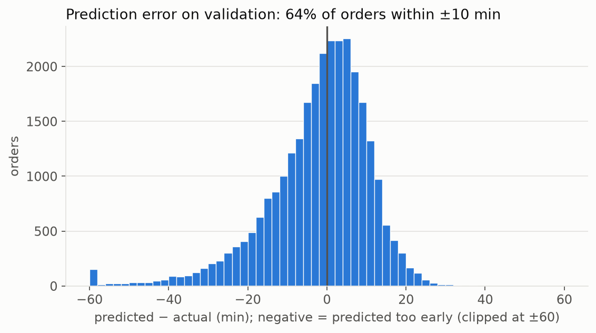
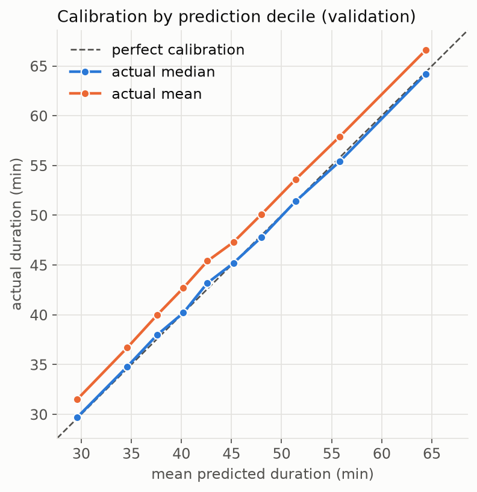
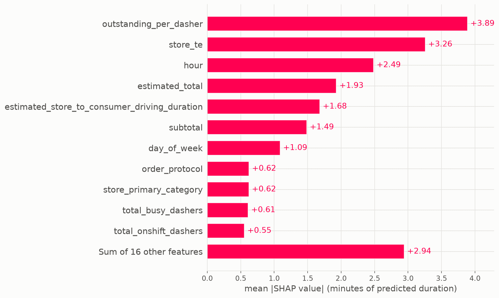
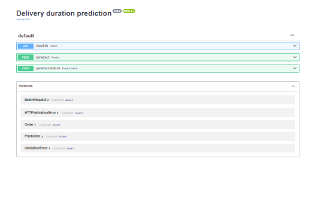

# Delivery Duration Prediction

Predicting how long a food delivery will take, from the moment the order is placed. The final model is a LightGBM regressor with a Huber loss. On a later, untouched four-day test window it is off by **10.5 minutes on average (MAE)**, which is 21% better than the best simple baseline built from the dataset's own time estimates, and it is served through a FastAPI app in a Docker image.

Based on the StrataScratch "Delivery Duration Prediction" take-home (DoorDash).

| Model (test set, Feb 14-17) | MAE (min) | 95% CI | RMSE (min) | Within ±10 min |
|---|---|---|---|---|
| Constant (train median) | 13.84 | n/a | 19.21 | 47.9% |
| Calibrated upstream estimate | 13.41 | [12.57, 14.29] | 18.15 | 46.5% |
| Ridge | 10.95 | [10.46, 11.44] | 15.21 | 57.4% |
| **LightGBM, Huber loss (final)** | **10.55** | **[9.98, 11.12]** | **15.08** | **60.9%** |

LightGBM beats Ridge by 0.41 min (paired 95% CI [-0.53, -0.30]) and the calibrated estimate by 2.86 min (paired 95% CI [-3.31, -2.46]). The intervals come from a block bootstrap over (date, hour) blocks, so they reflect variation inside the four test days only, not week-to-week variation.

## The problem

Each row is a delivered order with its creation time, store, market, basket size, and a snapshot of the marketplace at that moment (dashers on shift, busy, and outstanding orders), plus two upstream time estimates. The target is `duration = actual_delivery_time - created_at`, in seconds. The task is to predict it at order time, so every feature must be known when the order is created.

After cleaning there are 197,272 orders from January 21 to February 17, 2015 (Pacific days).

## Validation design

Random cross-validation would leak the future into the past, because orders from the same hour share the same marketplace conditions. So the split is by time, on Pacific calendar days:

| Split | Dates | Orders | Used for |
|---|---|---|---|
| Train | Jan 21 - Feb 9 | 138,475 | fitting |
| Validation | Feb 10 - 13 | 28,778 | model selection, early stopping |
| Test | Feb 14 - 17 | 30,019 | **one** final evaluation |

The test set was opened once, after every choice was frozen, and nothing was tuned on it afterwards. Learned features follow the same rule: the store target encoding is fit on training data only and computed out-of-fold (grouped by day) on the rows it trains on, with smoothing so rarely seen stores shrink toward the global mean.

## What I tried and what I learned

**The platform's own estimate is badly biased.** Taken at face value, the upstream estimate (`estimated_total`) is off by 32.9 min on validation and never over-predicts. A linear recalibration on the training set brings it to 12.2 min, which is the honest baseline to beat.

**Most of the signal is linear.** Ridge removes most of the error (MAE 10.05 vs 12.25 on validation) and its regularization strength barely matters. LightGBM adds a further 4%, so I treat the rest as noise that the features cannot explain: prep time, traffic, weather.

**The loss function is a trade-off, not a detail.** L1 and Huber predict the median and give the lowest MAE but under-predict on average. L2 predicts the mean and has the smallest bias but a higher MAE. I chose Huber (alpha = 600 s) for MAE and report bias next to it everywhere. On test the final model under-predicts by 3.0 min on average.

**Things that did not help.** A 12-point random search moved validation MAE only between 9.62 and 9.70, and blending Ridge into LightGBM gave nothing (9.625 vs 9.624). I kept default-like settings rather than chase noise.

**Store history helps.** Dropping the store encoding raises validation MAE from 9.63 to 9.95.

### Error analysis

<p align="center"></p>

- **Errors are spread evenly.** Segment MAE sits between 8 and 11.5 min almost everywhere, and order size does not drive error.
- **Scarce supply is the weakest regime.** With zero available dashers MAE is 11.15 min on 27% of rows (31% of total error); with 21 or more available it is 8.11.
- **Low-history stores are harder.** MAE falls from 11.37 (unseen store) to 8.79 (101 or more training orders).
- **The long tail carries the cost.** The worst 5% of orders contribute 20.5% of the total error, and 96% of them are late deliveries the model did not see coming (about 86 min actual vs 48 predicted).
- **Calibration is good where it matters.** The actual median tracks the prediction within 0.6 min across all deciles. The mean sits 2 to 2.5 min higher because durations are right-skewed, which is exactly the model's bias.

<p align="center"></p>

### What drives the predictions

<p align="center"></p>

SHAP (TreeExplainer) shows that **queue load per dasher** (3.9 min mean absolute contribution), **store history** (3.3) and **time of day** (2.5) matter more than the two upstream estimates (1.9 and 1.7). Queue per dasher behaves like a capacity threshold: flat below about one outstanding order per dasher, then adding roughly 15 min between one and two. More plots (beeswarm, dependence, single-order waterfalls) are in `reports/figures/` and in `notebooks/05_error_analysis.ipynb`.

## Run the service

The model, the store-to-category map and metadata are committed in `artifacts/` (4 MB), so the service starts without the training data.


```bash
docker build -t delivery-duration:0.6.0 .
docker run --rm -p 8000:8000 delivery-duration:0.6.0
```

Interactive docs are at `http://127.0.0.1:8000/docs`. Five fields are required; everything else is optional and a missing value is handled exactly as it was in training.
<p align="center"></p>

```bash
curl -s http://127.0.0.1:8000/predict -H "Content-Type: application/json" -d '{
  "store_id": 1845, "total_items": 3, "num_distinct_items": 3, "subtotal": 2500,
  "estimated_order_place_duration": 446, "created_at": "2015-02-14T01:30:00Z",
  "market_id": 1, "order_protocol": 1,
  "total_onshift_dashers": 33, "total_busy_dashers": 14, "total_outstanding_orders": 21,
  "estimated_store_to_consumer_driving_duration": 861
}'
# {"predicted_duration_seconds":3172.0,"predicted_duration_minutes":52.87,"store_known":true,"model_version":"0.6.0"}
```

| Endpoint | Purpose |
|---|---|
| `GET /health` | status, model version, test MAE |
| `POST /predict` | one order |
| `POST /predict/batch` | up to 1,000 orders |

Design notes:

- **One code path for training and serving.** The API calls the same cleaning, feature and model functions as the notebooks. Predictions from the saved model and the API match to 0.00 seconds, and the container returns the same number as a local install.
- **Strict input validation.** Impossible values (negative subtotal, wrong types, unknown fields) return 422. Odd but parseable values are cleaned the way they were in training.
- **Unseen stores still get a prediction** from the global-mean encoding, and the response says so with `store_known: false`.
- **Timestamps** without a timezone are read as UTC; features are computed in Pacific time.
- **Pinned runtime.** The image pins every library to the training versions, because the pickled model only loads reliably under the same versions.

## Limitations

- **Four weeks of data and a four-day test window.** A new week, or a holiday, could look different from what the intervals suggest. Weekly seasonality is untested.
- **Systematic under-prediction.** The median-targeting loss gives -3.0 min bias on test, and the tail of very long deliveries is the largest source of error. The model gives a point estimate with no uncertainty.
- **No outside signals.** Weather, traffic, events and restaurant prep time are not in the data, and I did not try to proxy them.
- **Category fallback.** When `store_primary_category` is not sent, it is looked up from `store_id`. In a check against the original rows, 4.2% of predictions differed by that substitution (mean 0.05 min, maximum 5.7 min).
- **Static model.** There is no retraining, drift monitoring or load testing.

## Next steps

1. Prediction intervals (for example a 90th-percentile model) to flag the long-delivery tail.
2. Richer store features, such as a per-store prep-time residual and recency weighting, for low-history stores.
3. Supply-trend features (recent dasher availability) for zero-availability periods.
4. Look into markets 1 and 3 and the Friday under-prediction.
5. External signals such as weather and events, and more weeks of data to validate seasonality. Evaluating any v2 needs fresh data, since this test set is spent.

## Repository layout

```
src/            cleaning, features, split, store encoder, metrics, modeling, pipeline, serving
app/            FastAPI service
artifacts/      trained model, store category map, metadata (what the service loads)
notebooks/      the analysis in order, with observations written next to the results
reports/figures/  figures used above and in the notebooks
scripts/        artifact export and train/serve parity check
tests/          unit and API tests (40)
Dockerfile, requirements-serve.txt
```

### Reproduce

The raw data is not included in the repo. Download the StrataScratch dataset (`historical_data.csv`) and place it in `data/datasets/`, then run the notebooks in order: `01_eda`, `02_cleaning` (writes `data/processed/`), `03_features`, `04_modeling` (writes the model to `models/`) and `05_error_analysis`. To refresh the files the service loads, run `python scripts/export_artifacts.py`. The tests need no data:

```bash
python -m venv .venv
.venv\Scripts\activate          # Windows; use `source .venv/bin/activate` on macOS/Linux
pip install -r requirements.txt
python -m pytest
```

Built with Python 3.11, pandas 3, scikit-learn, LightGBM, SHAP, FastAPI and Docker.
